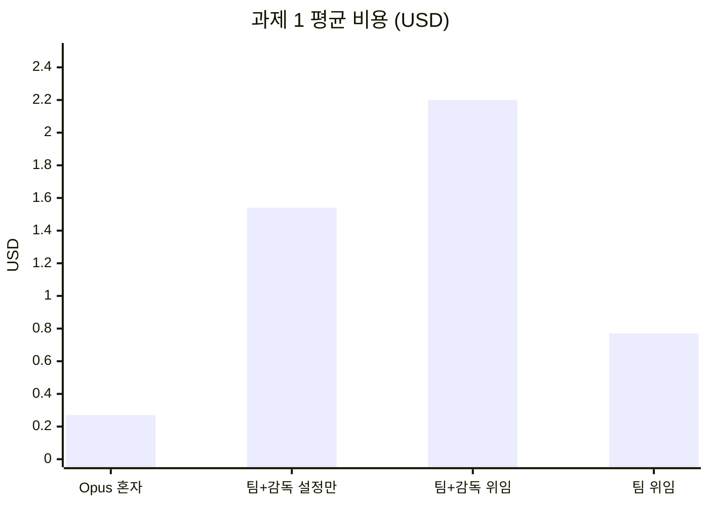
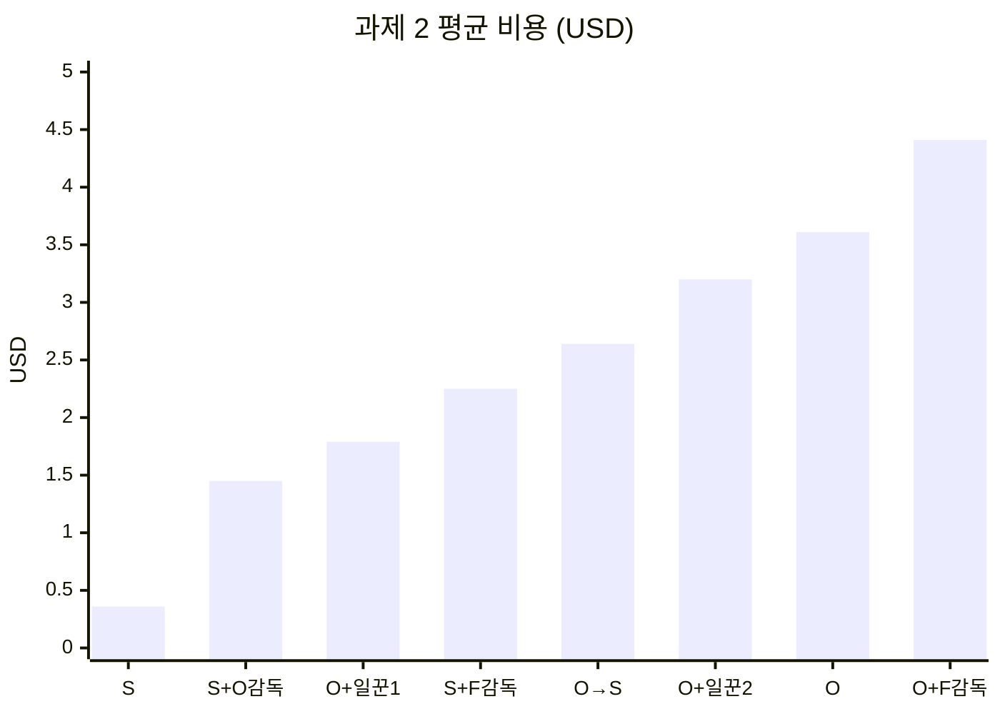

<div align="center">

# 🚇 advisor-bench

**Claude Code에 감독관(advisor)을 붙이면 정말 더 정확하고 쌀까?**

같은 과제를 모델 조합만 바꿔 가며 Claude Code에 시키고, 모델이 볼 수 없는 숨은 테스트로 채점합니다.




<sub>막차 러너 — 금색은 걸은 길, 노선 색은 탄 열차, 빨간 점선은 강제 퇴장</sub>

### [🎮 막차 러너 직접 해 보기](https://kyungchan3007.github.io/advisor-bench/)

</div>

---

## 📌 한눈에 보기

- **질문**: 감독관을 붙이면 실수가 줄어드나? 비용은 얼마나 느나? 서브에이전트와는 뭐가 다른가?
- **과제 1 (쉬움)**: 교통카드 정산 라이브러리 고치기 · 숨은 테스트 36개
- **과제 2 (어려움)**: 직접 만든 격자 게임 **막차 러너**의 최적 풀이기 짜기 · 숨은 레벨 23개
- **조합**: 쉬운 과제 4개 × 2회, 어려운 과제 8개 × 2~3회 = **26회** (+ 시험 실행)
- **측정**: 정답 · 모델별 비용 · 시간 · 감독관 호출 수 · 위임 수

### 결론 3줄

- 🧑‍⚖️ **감독관은 비용만 늘렸다** — 쉬운 과제에선 비용이 6~8배, 어려운 과제에서도 정답률은 그대로
- 🤖 **서브에이전트는 만들어만 두면 안 쓰인다** — 요청에 "누구에게 맡겨라"를 적어야 움직였다
- 💸 **가장 싸게 다 맞춘 건 Sonnet 혼자** — 어려운 과제 평균 $0.36, Opus 혼자의 1/10

---

## 🌱 출발점

- 유튜브에서 Claude Code **어드바이저** 실험 영상을 봄
  - 캡틴 Opus · 일꾼 Sonnet 서브에이전트 · 감독관 Fable
  - 쉬운 과제(N빵 정산) + 어려운 과제(미노타우로스 미궁)
  - 결론: 쉬운 과제는 Opus 혼자, 어려운 과제는 Sonnet 혼자가 가장 쌌다
- 같은 질문을 **다른 주제(지하철)** 로 직접 재 봄
- 짝 실험: [ontology-coding-bench](https://github.com/kyungchan3007/ontology-coding-bench) · [ontology-sql-bench](https://github.com/kyungchan3007/ontology-sql-bench)

### 영상과 내 결과 비교

| 항목 | 영상 | 이 저장소 |
|---|---|---|
| 쉬운 과제 Opus 혼자 | $0.96 | $0.27 |
| 쉬운 과제 + 감독관 · 팀 | $3.34 | $2.20 |
| 감독관 비용 비중 | 65~74% | 59~73% |
| 어려운 과제 최저가 | Sonnet $2.48 | Sonnet $0.36 |
| 어려운 과제 최고가 | Opus+Fable $5.71 | Opus+Fable $4.41 |
| Opus 혼자 오답 | 3회 중 2회 | 3회 중 0회 |
| 감독관 붙은 실행 오답 | 6회 중 1회 | 6회 중 1회 |

- 비용 순서 · 감독관 비중 · "감독관이 붙어도 틀린다"는 **영상과 같음**
- 다른 점: 이 저장소의 어려운 과제에선 **Opus 혼자도 다 맞춤** (아래 [틀린 1회](#-틀린-1회-분석) 참고)

---

## 🧩 구성

| 역할 | 모델 | 붙이는 법 |
|---|---|---|
| 캡틴 | Opus 5.5 | `--model opus --effort high` |
| 탐색 · 조사 · 일꾼 | Sonnet 5.5 | `.claude/agents/*.md` |
| 감독관 | Fable 5.1 | `.claude/settings.json` |

### 감독관 (advisor)

```json
{ "advisorModel": "fable" }
```

- 메인 모델이 중요한 순간에 **대화 전체**를 더 강한 모델에게 보여 주고 조언을 받는 기능
- 언제 부를지는 설정 못 함 → 모델이 스스로 판단
- `CLAUDE.md`에 한 줄: "큰 계획 전 · 같은 오류 두 번 · 끝내기 전에 감독관 확인"
- 켜졌는지는 실행 결과의 **모델별 비용**에 Fable이 따로 찍히는지로 확인
- 조언 내용은 암호화돼서 볼 수 없음

### 서브에이전트

```markdown
---
name: worker
model: sonnet
effort: medium
tools: Read, Write, Edit, Glob, Grep, Bash
---
```

| 이름 | 역할 | 도구 |
|---|---|---|
| explorer | 코드 조사 | 읽기만 |
| researcher | 문서 정리 | 읽기 + WebFetch |
| worker | 수정 · 실행 | 읽기 · 쓰기 · 실행 |

- 캡틴 effort는 실행 옵션 `--effort`로 직접 줌 (사용자 설정 파일의 effort는 무시됨)

---

## 🧮 과제 1 · 교통카드 정산 (쉬움)

- 가상 도시 **온톨시** 지하철 교통카드 라이브러리, 코드 파일 8개
- 걸린 일 4개
  - 거리 경계 버그 (정확히 10 · 15 · 50km에서 100원 더 붙음)
  - 승객 유형 할인 (청소년 · 어린이 · 경로, 10원 미만 버림)
  - 통합환승 정산 (30분 · 4회 · 거리 합산)
  - 이용내역 CSV (따옴표 · 쉼표 이스케이프)
- 규칙은 `docs/` 문서 3개에 흩어 둠
- 숨은 테스트 36개, 시작 코드는 8개만 통과

### 결과 (조합마다 2회)

| 조합 | 정답 | 평균 비용 | 시간 |
|---|---|---:|---:|
| Opus 혼자 | 36 · 36 | **$0.27** | 66초 |
| 팀 + 감독관 (설정만) | 36 · 36 | $1.54 | 216초 |
| 팀 + 감독관 (위임 지시) | 36 · 36 | $2.20 | 335초 |
| 팀 (위임 지시) | 36 · 36 | $0.77 | 200초 |



- **품질은 모두 같음** — 8회 전부 36/36
- **팀을 설정만 해 두면 한 번도 안 씀** — "설정만" 2회 모두 위임 0회, 감독관만 2회씩 불림
- **비용 차이는 거의 감독관** — 감독관이 붙은 실행에서 Fable이 비용의 59~73%
- **팀은 위임 지시를 넣어야 움직임** — 탐색 · 조사가 먼저 뛰고 일꾼이 고침, 대신 Opus 혼자보다 2.9배 비쌈

---

## 🚇 과제 2 · 막차 러너 (어려움)

**[▶ 브라우저에서 직접 해 보기](https://kyungchan3007.github.io/advisor-bench/)** — 방향키로 움직이고, 승강장에서 열차를 타고, 정답 재생도 볼 수 있습니다.

- 직접 만든 격자 게임: 승객을 **가장 빨리 → 그다음 가장 싸게** 목적지 출구로
- 과제: 레벨 JSON을 받아 최적 행동 문자열을 출력하는 `solver.js` 짜기
- 규칙 문서([rules.md](task2/docs/rules.md))만 주고 **판정 코드는 안 줌**
- 숨은 레벨 23개, 출력이 정답과 **글자 하나까지 같아야** 통과, 레벨당 10초

### 게임 규칙 요약

| 요소 | 규칙 |
|---|---|
| 1틱 행동 | 상하좌우 · 대기 |
| 에스컬레이터 | 화살표 방향만 |
| 열차 | 첫차 · 간격 · 막차 |
| 개찰구 | 나갈 때 거리 운임 |
| 30틱 재입장 | 같은 통행으로 이어짐 |
| 역 폐쇄 | 남아 있으면 강제 퇴장 |
| 순위 | 도착 → 요금 → 승차 → 사전순 |

- 행동 문자열 예: `RRUW[2외>시청]LLD` (`[노선>하차역]` = 승차)
- 운임은 과제 1과 같은 거리 운임 (선로 1칸 = 1km)

### 함정 레벨

| 분류 | 개수 | 함정 |
|---|---:|---|
| 쫓겨나야만 가는 곳 | 7 | 목적지가 벽에 갇힌 거리 |
| 쫓겨나는 게 지름길 | 4 | 먼 비상 출구로 보내짐 |
| 나갔다 다시 들어가기 | 4 | 30틱 재입장 |
| 막차 | 4 | 빠른 길은 막차를 놓침 |
| 함정 없음 | 4 | - |

- 분류마다 그 가정을 일부러 틀리게 넣은 풀이가 **실제로 다른 답**을 내는 레벨만 골랐음
- 숨은 레벨은 61×113칸, 노선 약 26개, `maxTick` 400

<div align="center">

<sub>h01 — 목적지(초록)는 벽에 갇힌 거리 안. 한 역에 일부러 남아 <b>쫓겨나는 것</b>(빨간 점선)만이 유일한 길</sub>
</div>

- 영상의 "열쇠를 들고 돌아오려면 일부러 구덩이에 빠져야 하는" 레벨과 같은 꼴
- "쫓겨나는 건 손해이니 버린다" 같은 최적화를 넣으면 `불가`가 나옴

### 공정한 난이도 만들기

- **v1은 너무 쉬웠음** — 50×70칸 · 강제 퇴장 없음
  - Opus 혼자 · Sonnet 혼자 모두 23/23, 레벨당 약 40ms
- **v2로 강화** (영상이 판정 코드를 빼고 규칙을 더한 것처럼)
  - 역 폐쇄 · 강제 퇴장 규칙 추가
  - 맵을 61×113칸, 노선 26개 안팎으로 키움
  - Opus 비용이 $0.99 → $3.59로 올라 영상 수준이 됨
- 모델이 틀릴 때까지 더 어렵게 만들지는 않음 → 그대로 본 실행

### 결과 (조합마다 2회, Opus · Sonnet 혼자는 3회)

| 조합 | 정답 | 평균 비용 | 시간 |
|---|---|---:|---:|
| Sonnet 혼자 | 23 · 23 · 23 | **$0.36** | 3분 |
| Sonnet + Opus 감독 | 23 · 23 | $1.45 | 14분 |
| Opus + 일꾼 1 | 23 · 23 | $1.79 | 10분 |
| Sonnet + Fable 감독 | 23 · 23 | $2.25 | 10분 |
| Opus 계획 → Sonnet 구현 | 23 · 23 | $2.64 | 16분 |
| Opus + 일꾼 2 | 23 · 23 | $3.20 | 19분 |
| Opus 혼자 | 23 · 23 · 23 | $3.61 | 26분 |
| Opus + Fable 감독 | **22** · 23 | $4.41 | 34분 |



<sub>그래프 축: S = Sonnet, O = Opus, F = Fable · 시간은 3개씩 동시에 돌린 벽시계 시간</sub>

- **가장 싸게 다 맞춘 건 Sonnet 혼자** — Opus 혼자의 1/10
- **가장 비싼 건 Opus + Fable 감독** — 그리고 유일하게 틀림
- **Opus에게 일꾼을 붙이면 오히려 쌌음** — 비싼 Opus 토큰을 Sonnet이 대신 씀 ($3.61 → $1.79)
- **일꾼 2명은 1명보다 79% 비쌈** — 같은 파일 충돌은 없었지만 위임이 최대 4번 오감
- **감독관 비용은 모델에 따라 다름** — Sonnet 메인에 Opus 감독이 Fable 감독보다 36% 쌌음

---

## 🔍 틀린 1회 분석

<div align="center">

</div>

- **Opus + Fable 감독 1회차**, 숨은 레벨 **h04** (쫓겨나야만 가는 곳, 가장 큰 상태 공간)
- 답은 **맞았음** — 다만 10.2초가 걸려 10초 제한을 넘김
- 같은 레벨에서 다른 실행은 0.08~2.4초
- 그 실행이 한 일
  - 자기 레벨 생성기 + 무작위 대조 검증 1,600번 (강제 퇴장 170번 포함)
  - 감독관을 3번 부르고, 정확성 검증에 공을 들임
  - 대신 가장 큰 경우의 속도는 놓침
- 감독관이 이 실수를 만들었는지 · 막지 못했는지는 **조언이 암호화돼 있어 알 수 없음**
- 영상처럼 "잘못된 가정"으로 틀린 실행은 **0회** — 강제 퇴장 · 재입장 · 막차 함정은 모든 실행이 정확히 처리

---

## 💸 감독관은 왜 비싼가

| 실행 | 호출 | 호출당 입력 토큰 | 캐시 읽기 |
|---|---:|---:|---:|
| 과제 1 팀 + 감독 | 2 | 3.3~4.7만 | 0 |
| 과제 2 Opus + Fable | 3 | 1.1~6.4만 | 0 |
| 과제 2 Sonnet + Fable | 1~2 | 3.0~3.8만 | 0 |
| 과제 2 Sonnet + Opus | 1~2 | 3.1~3.2만 | 0 |

- 부를 때마다 **지금까지의 대화를 처음부터 통째로** 읽음
- 이 읽기는 **캐시되지 않음** → 대화가 길수록 한 번 부르는 값이 커짐
- 서브에이전트는 반대: 맡은 일만 자기 컨텍스트에서 하고 요약만 돌려줌

| | 서브에이전트 | 감독관 |
|---|---|---|
| 직접 일함 | O | X |
| 보는 것 | 맡은 일만 | 대화 전체 |
| 맥락 손실 | 있을 수 있음 | 없음 |
| 비용 | 일한 만큼 | 부를 때마다 전체 |

---

## ✅ 정리

- **서브에이전트는 만들어만 두면 안 쓰인다** — 맡길 일을 요청에 직접 적어야 움직였다
- **감독관은 부를 때마다 대화 전체를 다시 읽어 비싸다** — 쉬운 과제에선 비용만 늘었고, 어려운 과제에서도 실수를 막아 주지 못했다
- **비싼 모델이 늘 더 정확한 건 아니다** — 어려운 과제를 Sonnet 혼자가 가장 싸고 빠르게 다 맞췄다
- **추천 순서**: 싼 모델로 먼저 돌려 보고 → 비용과 정답을 직접 잰 다음 → 필요할 때만 감독관을 켠다

---

## 🛠 재현하기

```bash
# 과제 1: 4조합 × 2회
node bench/run.mjs --task t1 --reps 2 --concurrency 2

# 과제 2: 조합 골라서
node bench/run.mjs --task t2 --combos opus-solo,sonnet-solo --reps 1

# 결과 표
node bench/report.mjs runs/full-t1 runs/full-t2 runs/full-t2-solo runs/pilot-v2

# 레벨 · 정답 다시 만들기 / 재생 SVG / 게임 페이지
node hidden/task2/levels.mjs
node tools/replay.mjs hidden/task2/levels/h01.json "<행동 문자열>" out.svg
node tools/site.mjs
```

- Claude Code CLI 2.1.251, Node 22
- 각 실행은 저장소 밖 빈 임시 폴더에서 돌림 (숨은 테스트를 못 보게)

## 📁 폴더

| 경로 | 내용 |
|---|---|
| `task1/` | 과제 1 시작 코드 · 문서 |
| `task2/` | 과제 2 과제 · 규칙 · 예시 레벨 |
| `hidden/` | 숨은 테스트 · 레벨 · 기준 풀이 |
| `bench/` | 실행기 · 조합 · 집계 |
| `tools/` | 재생 SVG · 게임 페이지 생성 |
| `docs/` | 게임 페이지 (GitHub Pages) |
| `runs/` | 실행 기록 · 채점 · 산출물 |

- `hidden/task2/engine.mjs`: 판정기 + 기준 풀이 (가장 이른 도착 → 역방향 가지치기 → 지배 관계로 요금 상태 줄이기)
- `hidden/task2/levels-v1/`: 너무 쉬웠던 첫 버전 레벨
- 실행 대화 기록(`runs/**/steps/`)은 크기 때문에 올리지 않음
